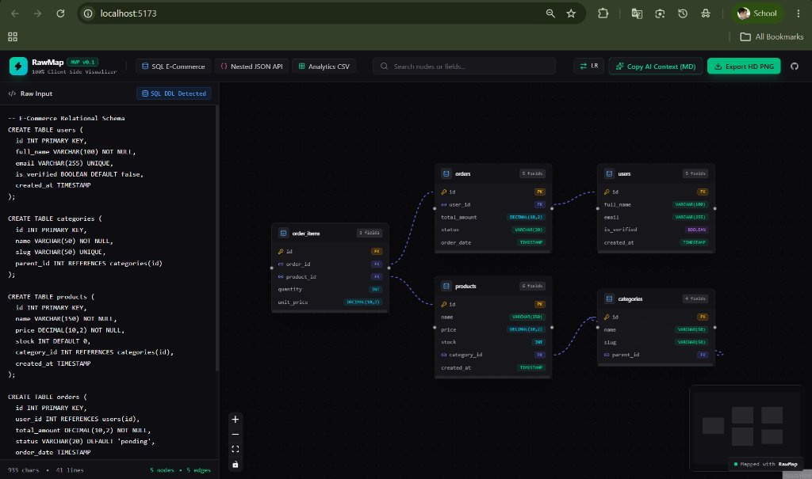

<div align="center">
  <h1>⚡ RawMap</h1>
  <p><strong>Turn raw JSON, SQL schemas, and CSVs into interactive node graphs & AI context maps in milliseconds.</strong></p>
  <p>100% Client-Side • Zero Login • Instant Visual Architecture • Built for Developers & Vibe Coders</p>
  <p>
    <a href="https://rawmap.vercel.app"></a>
    <a href="https://github.com/Yogiexc/rawmap/blob/main/LICENSE"></a>
    <a href="https://github.com/Yogiexc/rawmap/stargazers"></a>
  </p>
</div>

---

<div align="center">
  
</div>

## ✨ Why RawMap?
Most data visualizers only support a single format or upload your sensitive schemas to external servers. **RawMap** runs **100% in your browser** and bridges the gap between raw data visualization and AI-assisted coding:

- 🔀 **3-in-1 Universal Auto-Parser:** Paste raw **JSON payloads**, **SQL `CREATE TABLE` DDL**, or **CSV files**—RawMap automatically detects the format and renders the relationship graph in real-time.
- 🤖 **1-Click "Copy as AI Context":** Select any tables or nodes and export a clean, token-efficient Markdown schema map ready to paste into **Cursor, Antigravity, Claude Code, or ChatGPT**.
- 📸 **Screenshot-Ready Exports:** Export crisp, high-resolution PNG diagrams with custom dark/blueprint themes for your technical docs, PRs, and system design presentations.
- 🔒 **100% Local-First Privacy:** Your database schemas, API tokens, and production CSVs never leave your browser memory.

## 🚀 Quick Start (Local Development)

```bash
# 1. Clone the repository
git clone https://github.com/Yogiexc/rawmap.git
cd rawmap

# 2. Install dependencies
npm install

# 3. Start the local dev server
npm run dev
```

## 🗺️ Roadmap
- [x] Universal auto-detection for JSON, SQL DDL, and CSV
- [x] Interactive auto-layout (Horizontal LR & Vertical TB via Dagre)
- [x] 1-Click LLM Context Markdown generator
- [x] High-res PNG canvas export
- [ ] Export visual graph to Prisma Schema (.prisma) & Drizzle ORM
- [ ] TypeScript Interface (type / interface) generator from JSON/CSV
- [ ] Shareable encrypted URL links

## 🤝 Contributing
Contributions, issues, and feature requests are welcome! Feel free to check the [issues page](https://github.com/Yogiexc/rawmap/issues) or start a conversation in [Discussions](https://github.com/Yogiexc/rawmap/discussions).

## 📄 License
Licensed under the [MIT License](./LICENSE). Built with ❤️ by [@Yogiexc](https://github.com/Yogiexc).
